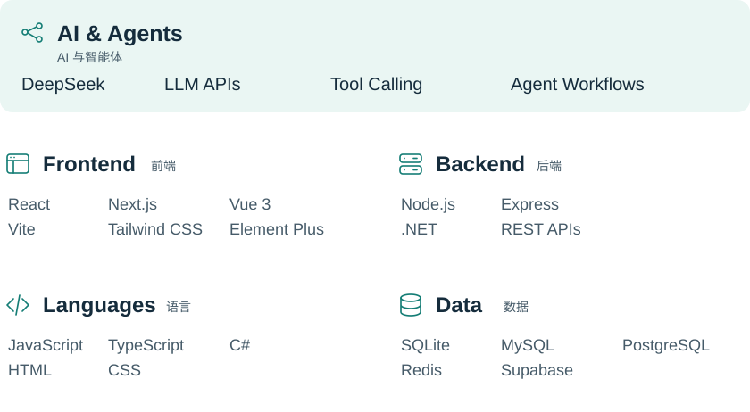

# Hi, I'm Lorin

我专注于 **AI Native 产品开发**，把大模型和 Agent 能力融入真实工作流；持续探索 **AI 搜索可见性、SEO / GEO 和商机线索发现**。

I build **AI Native products** that bring LLMs and agents into real workflows, with a focus on AI search visibility, SEO / GEO, and business lead discovery.

## What I use · 技术栈

<picture>
  <source media="(max-width: 600px) and (prefers-color-scheme: dark)" srcset="assets/tech-stack-dark-mobile.svg">
  <source media="(max-width: 600px)" srcset="assets/tech-stack-light-mobile.svg">
  <source media="(prefers-color-scheme: dark)" srcset="assets/tech-stack-dark.svg">
  
</picture>

## Open source projects · 开源项目

### [AI 线索助手 · Map AI Leads Agent](https://github.com/lorin-code/map-ai-leads-agent)

用自然语言查找高德地图公开 POI，支持多轮对话、线索筛选、会话保存和 CSV 导出。 
Finds public POI data from Amap through natural-language conversations, with lead filtering, saved sessions, and CSV export.

`Next.js` · `DeepSeek` · `SQLite` · `Amap API`

### [GoodieAI GEO Monitoring System](https://github.com/lorin-code/ai-geo-monitoring)

监测品牌在 AI 回答中的提及、引用和可见度。 
Tracks brand mentions, citations, and visibility across AI answers.

`Next.js` · `Express` · `SQLite / PostgreSQL`

### [SEO & GEO Audit Agent](https://github.com/lorin-code/seo-geo-audit-agent)

抓取网页并生成有依据的 SEO / GEO 评分和改进建议。 
Turns website signals into evidence-backed audits and prioritized fixes.

`Node.js` · `Express` · `SQLite`
